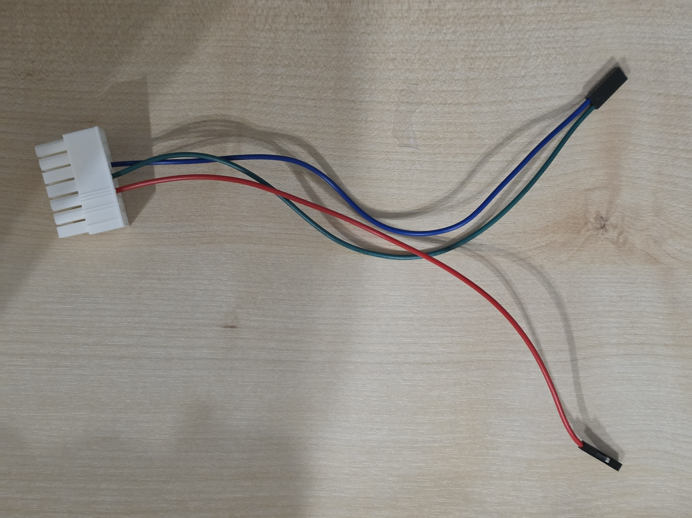
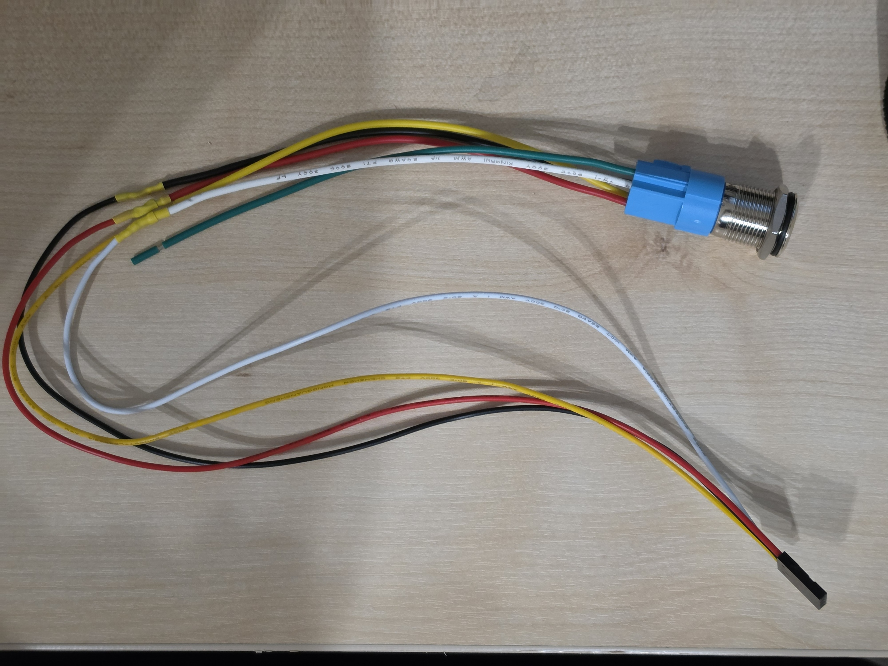
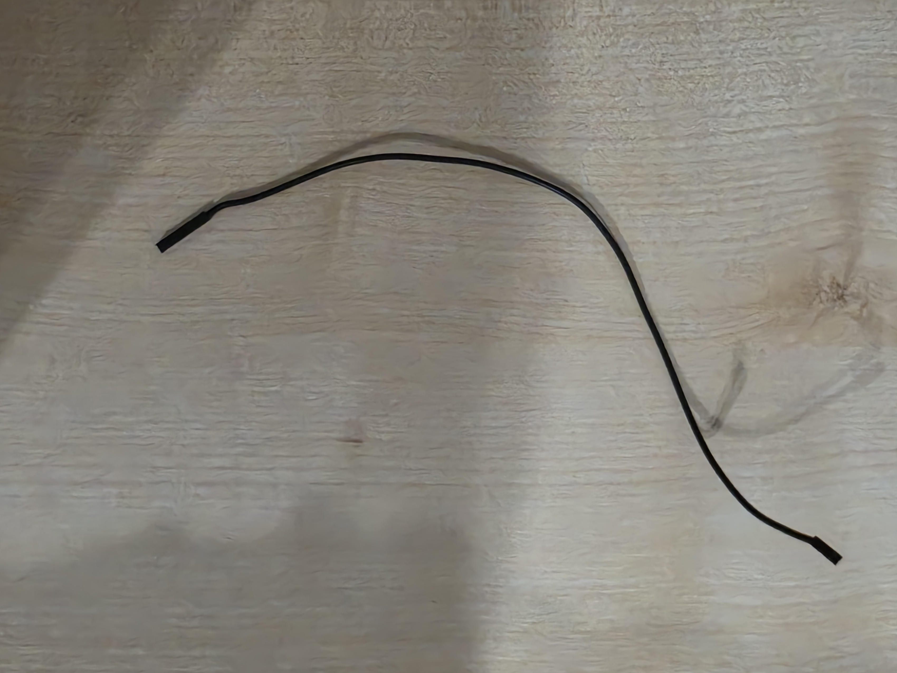
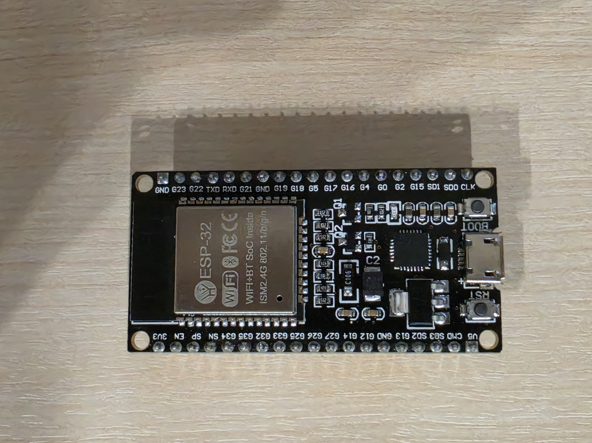
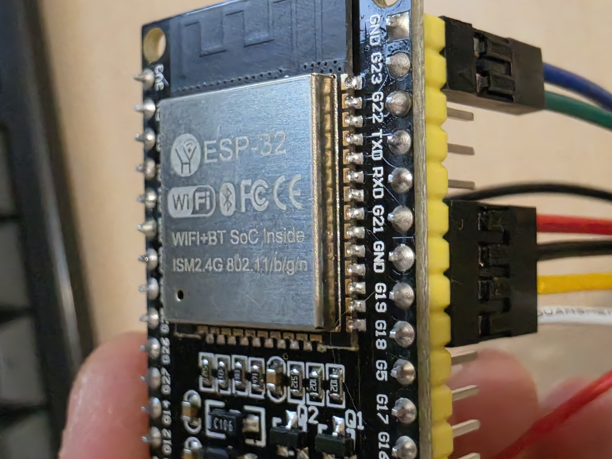
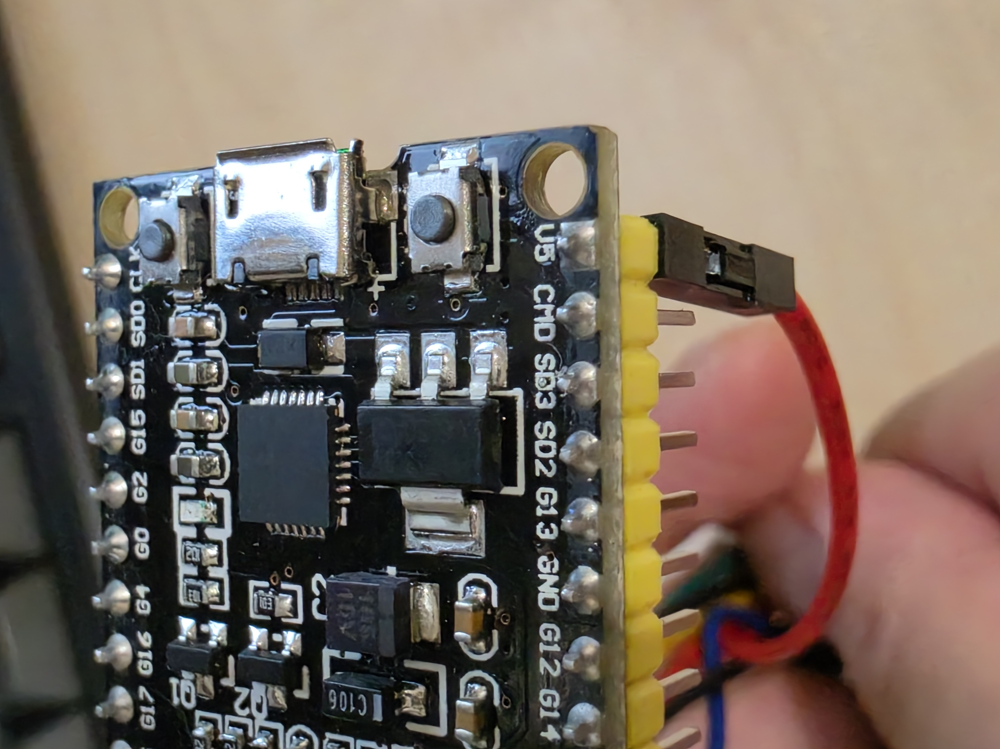
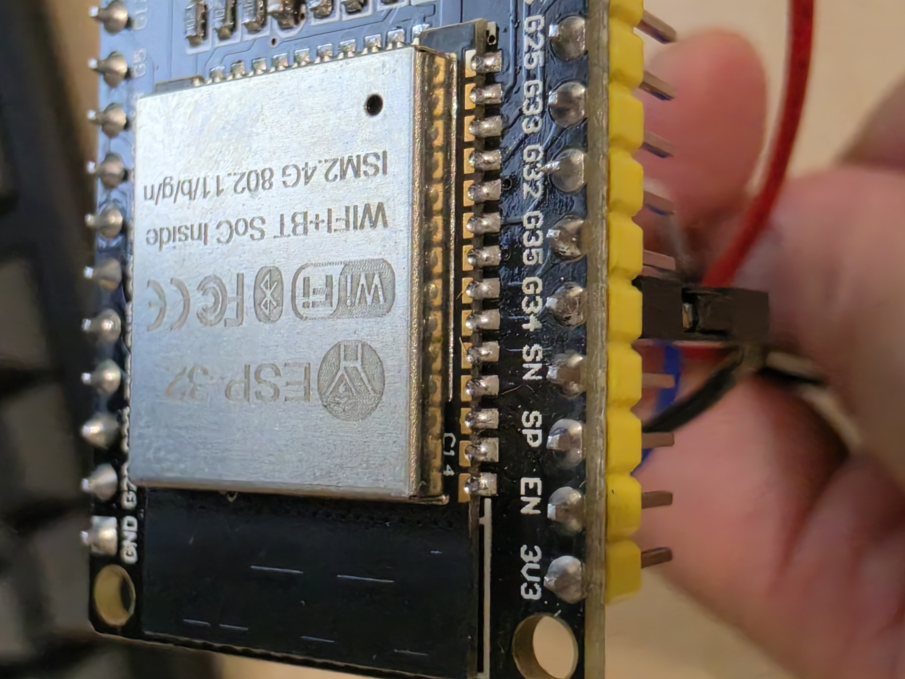
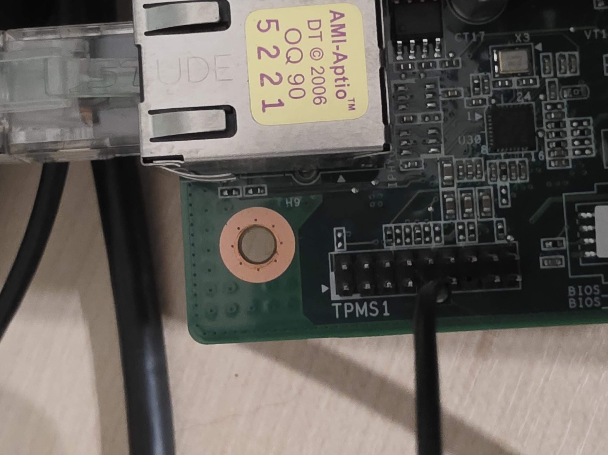
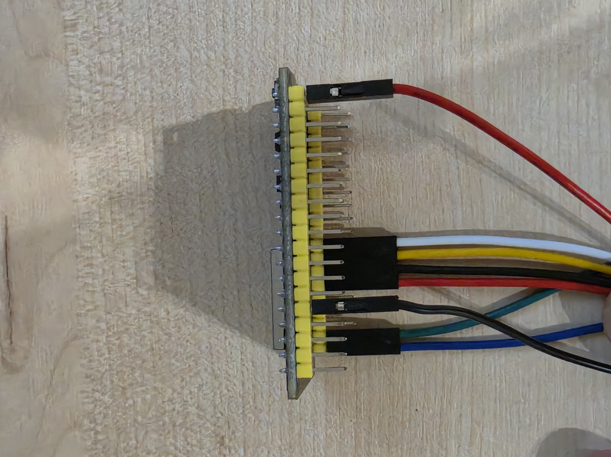
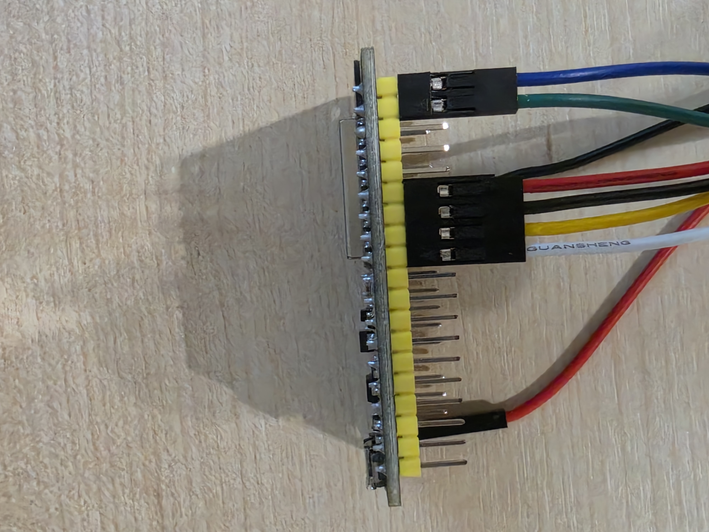

# BC250 전원 스위치

ESP32-WROOM-32용 사용 설명서 · 2026.10.12

### 전달받는 구성품 사진
아래 4가지 구성품을 확인한 뒤 다음 페이지의 배선 안내를 따라 연결하세요.

BC250 본체와 PSU 본체는 위 구성품에 포함되지 않습니다. 별도로 준비하세요.

<!-- pagebreak -->

## 01 / 케이블 연결하기

**PSU의 AC 전원 코드를 뽑고 연결하세요.** ESP32는 USB 단자가 아래로 오도록 놓습니다.

<!-- pinout: esp32 -->

1. **PSU 쪽:** 제공 케이블의 큰 커넥터를 해당 PSU의 대응하는 14핀/24핀 커넥터에 연결합니다. 홈과 걸쇠 방향을 맞춰 꽂으세요. 세 가닥 선은 이미 배선되어 있으므로 핀을 옮길 필요가 없습니다.
2. **ESP32 쪽:** PSU 케이블의 초록 선 → G23, 파란 선 → 맨 위 GND, 빨간 선 → V5.
3. **스위치 케이블:** 오른쪽 핀 열의 **위에서 아래로 G21·GND·G19·G18**에 1×4 커넥터를 꽂습니다. **빨간 선은 G21, 검은 선은 GND**에 맞추세요.
4. **검은 감지 케이블:** ESP32 G34와 BC250 TPMS1 9번을 연결합니다.

<!-- pagebreak -->

## 01 / 커넥터 방향 맞추기

<!-- pinout: connectors -->

커넥터가 한 칸 밀리지 않게 꽂으세요. 다음 사진에서 실제 연결 모습을 확인할 수 있습니다.

<!-- pagebreak -->

## 01-A / 설치 사진: 스위치와 PSU

아래 사진처럼 연결하세요. 보드에 인쇄된 이름과 도선 색으로 위치를 확인합니다.

**스위치의 빨간 선은 G21**, **PSU의 빨간 선은 V5**에 꽂습니다.

<!-- pagebreak -->

## 01-B / 설치 사진: 검은 감지 케이블

검은 감지 케이블의 양 끝을 아래 두 위치에 꽂으세요.

<!-- pagebreak -->

## 01-C / 설치 사진: 연결 완료

양쪽에서 연결한 위치를 확인하세요.

확인이 끝나면 ‘사용할 기능 고르기’를 읽고, 이어지는 ‘배선 후 처음 켜기’를 따라 전원을 넣으세요.

<!-- pagebreak -->

## 02 / 사용할 기능 고르기

배선을 마쳤다면 아래에서 사용할 기능을 고르세요. 여러 기능을 함께 사용할 수도 있습니다.

| 사용하려는 기능 | 필요한 설정 |
| --- | --- |
| 스위치를 눌러 BC250 켜기 | 추가 설정 없이 사용. 다음 페이지에서 처음 켜기를 확인하세요. |
| 컨트롤러로 BC250 켜기 | 포털에서 컨트롤러 등록. 이 기능만 쓰면 WiFi·MQTT 설정은 건너뛰세요. |
| 휴대폰 WoL 앱으로 BC250 켜기 | 포털에서 WiFi와 WoL 설정. MQTT·컨트롤러 등록은 건너뛰어도 됩니다. |
| Home Assistant에서 제어 | 포털에서 WiFi와 MQTT 설정. 컨트롤러 등록은 선택 사항입니다. |

### 설정 포털이란?
휴대폰이나 PC의 브라우저로 여는 ESP32 설정 화면입니다. ESP32가 만드는 **BC250 Switch Setup** WiFi에 연결해서 사용합니다.

이 **설정용 WiFi**와, WoL·Home Assistant를 위해 등록하는 **집의 공유기 WiFi**는 서로 다릅니다. 컨트롤러만 사용할 때도 설정 화면을 열기 위해 설정용 WiFi에는 연결해야 합니다.

### 설정 순서
**포털 열기 → 설정 시작 → WiFi → MQTT → 컨트롤러 등록 → 저장 후 재부팅** 순서로 진행합니다. 사용하지 않는 기능은 화면의 **‘건너뛰기’**를 누르세요.

‘저장 후 계속’은 해당 화면의 설정을 저장합니다. ‘건너뛰기’는 기존에 저장한 설정을 지우지 않습니다. 마지막에 **‘저장 후 재부팅’**을 눌러야 평소 사용하는 상태인 **일반 모드**로 돌아갑니다.

<!-- pagebreak -->

## 02 / 처음 켜기와 설정 포털

### 배선 후 처음 켜기
1. 앞의 배선 그림과 사진을 보고 커넥터 위치·방향을 다시 확인합니다. 스위치 빨간 선은 G21, PSU 빨간 선은 V5입니다.
2. PSU의 AC 코드를 연결하고 PSU 스위치를 켭니다. ESP32는 상시 전원으로 동작합니다.
3. 일반 모드에서 BC250이 꺼져 있으면 스위치를 짧게 눌렀다 놓습니다. **버튼을 놓을 때** BC250이 켜집니다.
4. 스위치 LED가 계속 켜지고, BC250 화면에 운영체제가 뜨는지 확인합니다. 켜지는 동안 LED가 잠시 빠르게 깜빡일 수 있습니다.

LED가 꺼져 있어도 정상 대기일 수 있습니다. 처음부터 빠르게 깜빡이며 **BC250 Switch Setup** WiFi가 보인다면 이미 포털 모드입니다. 다음 페이지의 접속 안내를 따르세요.

### 포털 모드 켜기
1. 켜진 BC250은 먼저 Steam 또는 운영체제 메뉴에서 종료합니다. PSU의 AC 전원은 연결된 상태로 둡니다.
2. BC250이 꺼진 상태에서 **스위치 LED가 빠르게 점멸할 때까지** 스위치를 계속 누릅니다.
3. 빠른 점멸이 시작되면 버튼을 놓습니다. 계속 누르고 있으면 포털 종료 동작까지 이어질 수 있습니다.

대신 ESP32의 **BOOT 버튼을 스위치 LED가 빠르게 점멸할 때까지 누른 뒤 놓아도 됩니다.** 전원을 켠 뒤에 조작하세요. 전원을 넣으면서 BOOT를 누르거나, BOOT와 RST를 함께 누르지 마세요.

<!-- boot-photo -->

<!-- pagebreak -->

## 02 / 설정 포털 접속과 종료

### 포털에 들어갔는지 확인하고 접속
1. 스위치 LED가 **빠르게 계속 깜빡이는지** 확인합니다.
2. 휴대폰/PC WiFi 목록에서 **BC250 Switch Setup**에 연결합니다. 비밀번호는 없습니다.
3. ‘인터넷에 연결되지 않음’이 떠도 이 WiFi 연결을 유지합니다.
4. 브라우저 주소창에 **http://192.168.4.1**을 입력합니다. ‘설정 시작’을 누르고 필요한 경우 한국어를 선택합니다.

LED 속도를 구분하기 어렵다면 **WiFi 이름과 포털 화면**으로 확인하세요. 평소의 버튼·컨트롤러·WoL 사용은 포털을 종료한 뒤 확인하세요.

### 포털 모드 종료하기
**화면에서:** 각 단계를 ‘저장 후 계속’ 또는 ‘건너뛰기’로 지나 ‘설정 완료’ 화면으로 갑니다. 장치 이름과 요약을 확인하고 **‘저장 후 재부팅’**을 누릅니다.

**BOOT 버튼으로 종료하기:** BC250 등록을 위해 켜 놓았다면 먼저 운영체제에서 종료하세요.

1. 포털 상태에서 ESP32의 **BOOT 버튼을 꾹 누릅니다.** 위치는 앞 페이지 사진을 참고하세요.
2. **스위치 LED의 빠른 점멸이 멈추면 바로 버튼을 놓습니다.** ESP32가 재부팅하며 일반 모드로 돌아갑니다.
3. 휴대폰/PC에서 **BC250 Switch Setup 연결이 끊기고, WiFi 목록에서도 사라지는지** 확인합니다. 목록이 남아 보이면 잠시 뒤 새로 고침하세요.

**점멸이 멈춘 뒤에는 계속 누르지 마세요.** 재부팅 후에도 오래 누르고 있으면 다시 포털에 들어갈 수 있습니다. 스위치를 길게 눌러도 같은 방법으로 종료할 수 있습니다.

이미 저장한 설정은 유지되지만, 입력만 하고 저장하지 않은 값은 반영되지 않습니다. **브라우저를 닫거나 휴대폰 WiFi만 바꾸는 것은 포털 종료가 아닙니다.**

<!-- pagebreak -->

## 02 / 포털 화면 예제: 시작

예제 화면: PC에서 실제 포털을 실행한 캡처입니다. 네트워크·계정·주소는 설명용 가상 값이며, 본인 환경의 값을 사용하세요.

<!-- portal-screen: start -->

**설정 시작**을 누릅니다. 공장 초기화는 기존 설정을 모두 지우므로, 일반 설정에는 사용하지 마세요.

<!-- pagebreak -->

## 03 / WiFi · MQTT · Wake-on-LAN

### WiFi 네트워크 연결
1. ‘WiFi 네트워크 연결’에서 사용할 **2.4GHz WiFi**를 선택합니다. 목록에 없으면 ‘네트워크 이름’에 SSID를 직접 입력합니다.
2. WiFi 비밀번호를 입력합니다. 처음 등록하는 보안 네트워크라면 비밀번호가 필요합니다.
3. WoL을 사용할 경우 아래 항목도 설정한 뒤 **‘저장 후 계속’**을 누릅니다.

포털을 종료하면 ESP32가 저장한 공유기 WiFi에 연결합니다. 연결이 안 되면 WiFi 이름과 비밀번호를 확인하세요.

### Wake-on-LAN 설정과 사용
**WoL을 쓰려면 ESP32의 WiFi 설정과 실제 WiFi 연결이 반드시 필요합니다.** BC250에 유선 LAN만 연결한 상태로는 이 장치의 WoL 기능을 쓸 수 없습니다. MQTT는 설정하지 않아도 됩니다.

1. WiFi 화면에서 **‘LAN 매직 패킷으로 머신 깨우기’**를 체크합니다.
2. 표시되는 **‘WoL 앱에 입력할 MAC 주소’**를 기록합니다. **ESP32의 WiFi 주소**이며, BC250의 LAN 주소나 컨트롤러 등록 때 나오는 Bluetooth 주소와 다릅니다.
3. WiFi 설정을 ‘저장 후 계속’으로 저장하고, 마지막 화면에서 ‘저장 후 재부팅’으로 포털을 종료합니다.
4. 같은 로컬 네트워크의 휴대폰 WoL 앱 등에 기록한 MAC을 등록합니다. 전송 방식은 **브로드캐스트**, 포트는 **UDP 9**로 설정합니다.
5. ESP32가 공유기에 연결된 뒤 BC250이 꺼진 상태에서 매직 패킷을 보내 전원이 켜지는지 확인합니다.

WoL 앱에서 브로드캐스트 주소도 요구하면 마지막 ‘문제가 생겼을 때’의 WoL 안내를 참고하세요.

### Home Assistant / MQTT 설정
Home Assistant 연동을 쓸 때 설정합니다. 먼저 같은 네트워크에서 접근 가능한 MQTT 브로커를 준비하고, Home Assistant도 그 브로커에 연결해 두세요.

| 포털 항목 | 입력할 내용 |
| --- | --- |
| 브로커 호스트 | MQTT 브로커의 IP 또는 호스트명. 예: 192.168.0.10 |
| 포트 | 브로커의 MQTT 포트. 기본값 1883 |
| 사용자 이름 / 비밀번호 | 브로커에 등록된 계정. 익명 접속 허용 시에만 생략 |

‘저장 후 계속’을 누르고 마지막에 ‘저장 후 재부팅’으로 끝냅니다. WiFi와 MQTT가 연결되면 Home Assistant의 MQTT 통합에서 장치와 전원·보드 상태 등의 항목을 확인합니다. 장치 이름은 마지막 화면에서 정할 수 있습니다.

Home Assistant를 쓰지 않으면 MQTT는 건너뛰세요. 기존 WiFi/MQTT 비밀번호 입력란을 건드리지 않으면 저장된 비밀번호가 유지됩니다.

<!-- pagebreak -->

## 03 / 포털 화면 예제: WiFi와 WoL

예제 화면: PC에서 실제 포털을 실행한 캡처입니다. 네트워크·계정·주소는 설명용 가상 값이며, 본인 환경의 값을 사용하세요.

<!-- portal-screen: wifi -->

WiFi 이름과 비밀번호를 입력하세요. WoL을 쓰려면 **LAN 매직 패킷으로 머신 깨우기**를 체크하고, 실제 화면에 표시된 MAC을 WoL 앱에 입력합니다. **저장 후 계속**을 누릅니다.

<!-- pagebreak -->

## 03 / 포털 화면 예제: MQTT

예제 화면: PC에서 실제 포털을 실행한 캡처입니다. 네트워크·계정·주소는 설명용 가상 값이며, 본인 환경의 값을 사용하세요.

<!-- portal-screen: mqtt -->

본인 MQTT 브로커의 주소·포트·계정을 입력하고 **저장 후 계속**을 누릅니다. 사용하지 않으면 **건너뛰기**를 선택하세요.

<!-- pagebreak -->

## 04 / 컨트롤러 등록

먼저 컨트롤러가 BC250에서 정상 작동하는지 확인하세요. 아래 **[포털]은 휴대폰/PC**, **[BC250]은 게이밍 모드 화면**에서 조작합니다.

### BC250 주소를 먼저 등록
1. **[포털] ‘컨트롤러로 깨우기’** 화면을 열어 둡니다. 등록 중에는 이 화면을 닫지 마세요.
2. **[포털] ‘BC250 켜기’**를 누릅니다.
3. **[BC250] Steam → 설정 → Bluetooth**를 열고 **BC250 Power Setup**을 선택합니다.

<!-- gaming-example -->

설명용 생성 이미지입니다. 실제 Steam 화면과 모양이 다를 수 있습니다.

4. **[포털]** Steam에 연결 실패가 떠도 정상입니다. **‘감지된 BC250 주소’에 주소가 나타나면 ‘이 BC250 저장’**을 누릅니다. 이 주소는 BC250의 Bluetooth 주소로, WoL용 주소와 다릅니다.

<!-- host-address-example -->

포털 캡처의 주소는 예시입니다. 저장하면 입력 칸이 사라지고 **‘저장된 BC250’에 주소가 표시됩니다.** 이미 같은 BC250이 저장되어 있다면 다음 단계로 진행하세요.

5. **[BC250]** Steam/운영체제 메뉴에서 종료합니다. **[포털]** ‘BC250 꺼짐’을 확인한 뒤 **‘컨트롤러 단계로 계속’**을 누릅니다.

<!-- pagebreak -->

## 04 / 컨트롤러 선택과 확인

**[휴대폰/PC]** ESP32가 재부팅하면 설정용 WiFi가 잠시 끊깁니다. **BC250 Switch Setup**에 다시 연결하고 **http://192.168.4.1**을 여세요. 컨트롤러 목록이 나오면 아래에서 사용하는 종류의 절차를 따릅니다. 다른 컨트롤러는 꺼 두세요.

### PlayStation: 컨트롤러 선택
1. BC250을 꺼 둔 채, 해당 BC250과 페어링되어 있는 컨트롤러의 **PS 버튼만** 누릅니다.
2. 목록의 **PlayStation (PS button)** 항목을 눌러 선택합니다. 여러 개라면 하나씩 같은 방법으로 추가합니다.
3. 최대 **4개**까지 선택하고 **‘저장 후 계속’**을 누릅니다. 마지막에 ‘저장 후 재부팅’으로 끝냅니다.

**PS5의 Create + PS, PS4의 SHARE + PS로 ESP32에 페어링하지 마세요.** 기존 BC250과의 페어링이 바뀔 수 있습니다. 이 등록 절차는 기존 페어링을 유지하면서 깨우기에 쓸 주소를 저장합니다.

### Xbox / 기타 Bluetooth 컨트롤러 선택
앞 페이지의 BC250 주소 등록과 위의 재접속을 마친 상태에서 진행합니다. 주소 등록을 다시 할 필요는 없습니다.

1. BC250과 이미 페어링된 컨트롤러를 준비합니다. BC250을 꺼 둔 상태에서 **Xbox 버튼으로 컨트롤러 전원만 켜고** 포털 목록에서 확인하세요. 기타 컨트롤러도 평소 전원을 켜는 버튼을 사용합니다. 보이지 않으면 컨트롤러를 껐다 켜고 **‘다시 스캔’**을 누르세요.
2. 포털 목록에서 해당 항목을 선택하고 **‘저장 후 계속’**, 마지막에 **‘저장 후 재부팅’**을 누릅니다.
3. BC250이 켜진 뒤 기존 연결로 실제 게임 조작도 되는지 확인하세요.

**등록을 위해 페어링 버튼을 길게 누르거나 다른 기기와 새로 페어링하지 마세요.** 계속 검색되지 않으면 해당 모델의 지원 여부를 확인해야 합니다.

PlayStation과 Xbox 등을 함께 쓰면 같은 목록에서 추가할 수 있습니다. **합계 최대 4개**이며, 기타 컨트롤러는 BLE 방식 지원 여부에 따라 검색되지 않을 수 있습니다.

### 등록 후 확인 / 수정
포털을 종료하고 BC250을 꺼 둔 뒤 PS 버튼 또는 Xbox 등 컨트롤러 전원을 켜 BC250이 켜지는지 확인하세요. 방금 종료했다면 컨트롤러를 끄고 스위치 LED의 느린 점멸이 멈춘 뒤 시도하세요.

목록이 비어 있으면 화면을 열어 둔 채 **‘다시 스캔’**을 누릅니다. 이 버튼은 저장된 등록을 지우지 않습니다. 등록을 바꾸려면 포털에서 원하는 항목을 선택/해제하고 저장하세요. 선택을 모두 비우고 저장하면 컨트롤러 깨우기를 끕니다.

<!-- pagebreak -->

## 04 / 포털 화면 예제: 컨트롤러 선택

예제 화면: PC에서 실제 포털을 실행한 캡처입니다. 네트워크·계정·주소는 설명용 가상 값이며, 본인 환경의 값을 사용하세요.

<!-- portal-screen: controllers -->

등록할 컨트롤러를 눌러 노란 테두리로 선택한 뒤 **저장 후 계속**을 누릅니다. 예제에서는 Xbox 한 개를 선택했습니다. 합계 최대 4개를 등록할 수 있습니다.

**Xbox는 Xbox 버튼으로 전원만 켜세요.** 목록에 없으면 껐다 켠 뒤 ‘다시 스캔’을 누릅니다. 등록을 위해 페어링 버튼을 길게 누르지 마세요.

<!-- pagebreak -->

## 04 / 포털 화면 예제: 완료

예제 화면: PC에서 실제 포털을 실행한 캡처입니다. 네트워크·계정·주소는 설명용 가상 값이며, 본인 환경의 값을 사용하세요.

<!-- portal-screen: done -->

장치 이름과 설정 내용을 확인하고 **저장 후 재부팅**을 누르면 일반 모드로 돌아갑니다.

<!-- pagebreak -->

## 05 / 평소 사용과 스위치 LED

### 버튼 조작 한눈에 보기
| 현재 상태 | 조작 | 결과 |
| --- | --- | --- |
| 일반 모드, BC250 꺼짐 | 짧게 눌렀다 놓기 | BC250 켜기 |
| 일반 모드, BC250 켜짐 | 스위치를 5초 이상 누르기 | 강제 전원 차단 |
| 일반 모드, BC250 꺼짐 | 스위치 또는 BOOT를 스위치 LED가 빠르게 점멸할 때까지 누른 뒤 놓기 | 포털 모드 진입 |
| 포털 모드 | BOOT 또는 스위치를 누르다가 LED의 빠른 점멸이 멈추면 놓기 | 포털 종료, 일반 모드로 재부팅 |

**평소 종료는 Steam/운영체제의 종료 메뉴를 사용하세요.** 켜진 상태에서 버튼을 짧게 누르는 것은 정상 종료 명령이 아닙니다. 5초 누르기, 포털의 강제 종료, Home Assistant 전원 끄기는 PSU 전원을 직접 끊으므로 응답 없는 상황에 사용하세요.

PSU의 AC 전원과 뒷면 스위치는 켜 둬야 ESP32가 대기하며 버튼·컨트롤러·WoL 신호를 받을 수 있습니다.

### 스위치 안의 LED가 알려 주는 상태
ESP32 보드 자체의 전원 LED가 아니라, **제공된 스위치의 LED**를 확인하세요.

| LED 모습 | 의미 / 할 일 |
| --- | --- |
| 꺼짐 | 일반 모드에서 BC250 꺼짐, 깨우기 대기. 이것만으로 ESP32 전원 불량이라고 판단하지 않음 |
| 계속 켜짐 | BC250 켜짐. 부팅이 끝났는지는 BC250 화면에서 확인하세요. |
| 빠르게 계속 깜빡임 | 설정 포털 모드. BC250 Switch Setup WiFi가 보이는지 확인하고 접속하세요. |
| 전원을 켠 직후 잠시 더 빠르게 깜빡임 | BC250이 켜지기를 기다리는 중입니다. |
| 종료 후 느리게 깜빡임 | 컨트롤러로 다시 켜기 전 대기 중. 컨트롤러를 끄고 점멸이 끝날 때까지 기다리세요. |

포털 모드에서는 포털 점멸이 우선합니다. 따라서 포털 화면에서 BC250을 켜도 LED는 포털 패턴으로 깜빡입니다. WiFi/MQTT 연결 성공이나 실패를 구분하는 별도 LED 패턴은 없습니다.

### 종료 직후 컨트롤러로 다시 켜지지 않는 이유
종료 직후 컨트롤러가 보내는 신호 때문에 BC250이 저절로 켜지는 것을 막기 위한 대기입니다. **등록한 컨트롤러를 모두 끄고, 스위치 LED의 느린 점멸이 멈춘 뒤 다시 켜세요.** 기다리는 중에도 일반 모드에서 스위치를 짧게 눌러 직접 켤 수 있습니다.

<!-- pagebreak -->

## 06 / 문제가 생겼을 때

### 버튼을 눌러도 BC250이 켜지지 않음
포털 모드라면 먼저 종료하세요. 일반 모드에서는 짧게 누른 **뒤 놓아야** 켜집니다. 계속 안 되면 PSU AC 코드를 뽑고 배선을 점검하세요. PSU 케이블은 빨강 → V5, 초록 → G23, 파랑 → 맨 위 GND입니다. 스위치는 빨강 → G21, 검정 → GND입니다.

### 켜려다가 약 10초 뒤 다시 꺼짐
전원을 넣은 뒤 10초 안에 TPMS1의 보드 켜짐 신호가 들어오지 않으면 전원을 차단합니다. AC 전원을 분리한 뒤 TPMS1 **9번 → G34** 연결을 확인하세요. 배선이 맞으면 BC250 자체의 전원/부팅 상태를 확인합니다.

### 설정 WiFi 또는 포털 화면이 안 보임
BC250을 종료한 뒤 스위치 LED가 빠르게 점멸할 때까지 스위치를 누르고, 점멸이 시작되면 놓으세요. **BC250 Switch Setup**에 연결되어 있는지 확인하고 **http://192.168.4.1**을 직접 입력합니다. 휴대폰이 인터넷 없는 WiFi를 떠나지 않도록 연결 유지를 선택하세요. 필요하면 모바일 데이터 자동 전환을 잠시 끕니다.

### 컨트롤러가 목록에 없거나 깨우지 못함
포털의 컨트롤러 목록을 열어 둔 채 하나씩 켜고 ‘다시 스캔’을 사용합니다. PlayStation은 BC250 주소 저장 후 ‘컨트롤러 단계로 계속’을 통한 재부팅이 필요하며, 기존 BC250과 페어링된 컨트롤러의 PS 버튼만 누릅니다. 일반 사용 때는 포털이 종료되었는지, 선택 후 저장했는지 확인하세요. 종료 직후라면 컨트롤러를 끄고 느린 LED 점멸이 끝날 때까지 기다립니다.

### WoL로 켜지지 않음
WiFi 이름/비밀번호와 ‘LAN 매직 패킷으로 머신 깨우기’ 체크를 저장했는지 확인합니다. 포털을 종료한 뒤 공유기 접속 목록에서 ESP32가 연결되어 있는지 확인하세요. 포털에 표시된 WoL MAC, UDP 9, 같은 네트워크의 브로드캐스트 설정을 확인합니다. 게스트 네트워크나 기기 격리는 피하세요.

WoL 앱이 브로드캐스트 주소를 요구하면 공유기 네트워크에 맞게 입력합니다. 예: IP가 192.168.0.x, 서브넷 마스크가 255.255.255.0이면 192.168.0.255입니다. WiFi 목록을 새로 검색하려면 포털을 종료했다가 다시 여세요.

### Home Assistant에 장치가 보이지 않음
ESP32의 WiFi 접속, 브로커 주소/포트/계정, Home Assistant의 MQTT 통합이 같은 브로커에 연결되어 있는지 확인합니다. MQTT 정보를 입력한 뒤 저장하고 일반 모드로 재부팅해야 합니다. 브로커에 연결되지 않아도 일반 모드의 버튼 제어는 사용할 수 있습니다.

### 모든 설정을 지우고 다시 시작
공장 초기화는 WiFi, MQTT, 컨트롤러 목록, BC250 Bluetooth 주소, 장치 이름 등 저장 설정을 지웁니다. 단순히 포털을 종료하려는 경우에는 사용하지 마세요.

- **포털에서:** 첫 화면의 ‘공장 초기화…’ → ‘전부 지우고 재부팅’을 누릅니다.
- **버튼으로:** 일반 모드에서 BC250이 꺼진 상태로 스위치와 ESP32의 BOOT 버튼을 **동시에 15초 이상** 누릅니다. 재부팅하면 두 버튼을 놓습니다.

초기화 후에는 설정 포털로 들어갑니다. ‘BC250 Switch Setup’에 다시 연결해 필요한 기능을 등록하세요.

이 설명서는 제공되는 ESP32-WROOM-32 구성 기준입니다. 버전에 따라 화면 모양이나 문구가 다를 수 있습니다.
